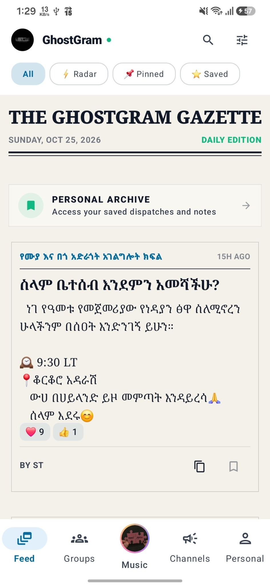
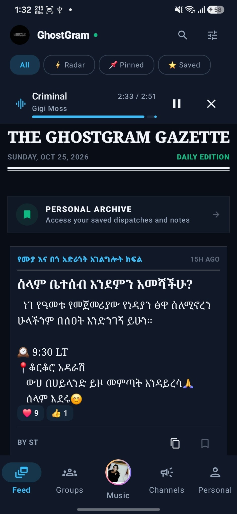
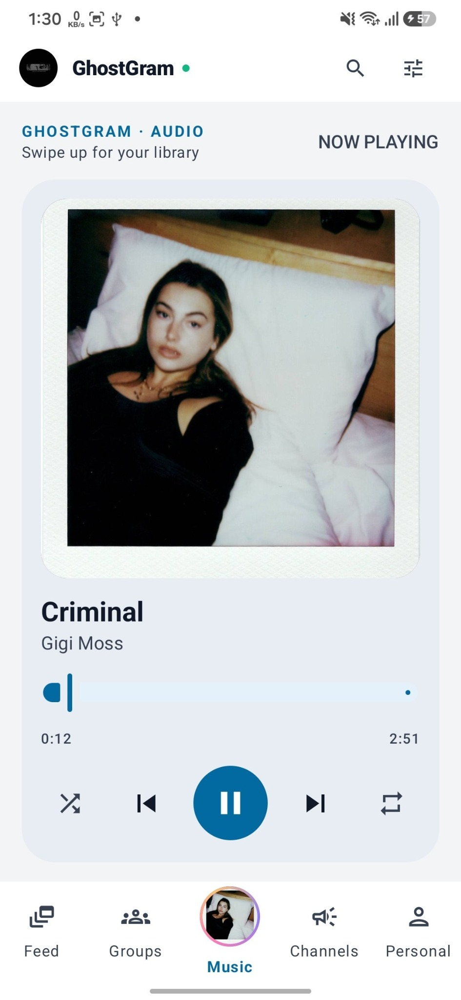
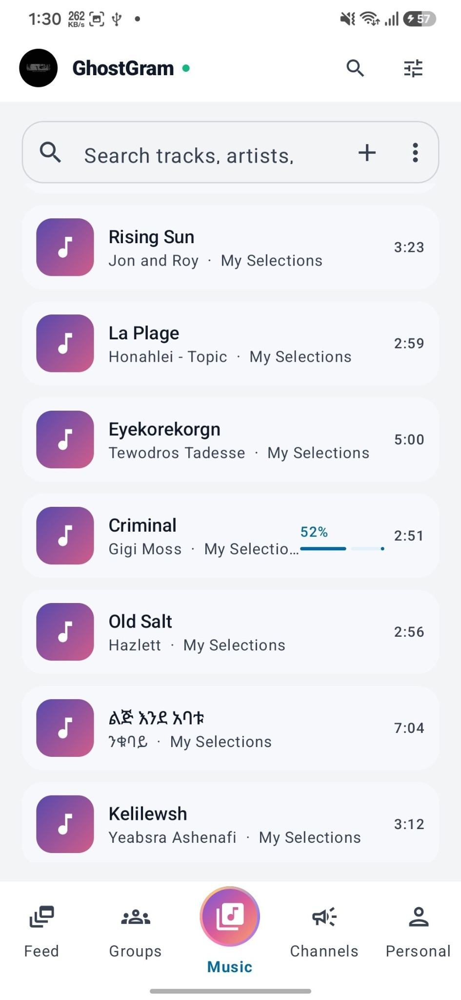
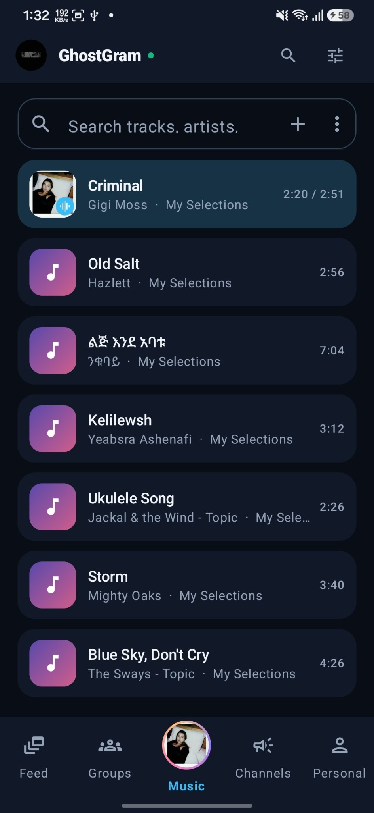
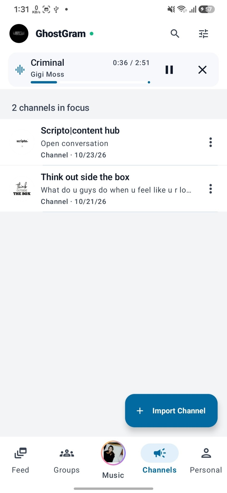
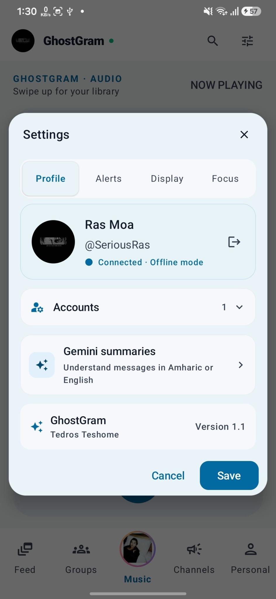

<div align="center">

# 🗞️ GhostGram

### Your Telegram updates, without the noise.

**A focused, read-oriented Telegram client for Android — combining a newspaper-style feed, curated channels, a personal archive, and an integrated music player.**

[](https://developer.android.com/)
[](https://developer.android.com/compose)
[](https://github.com/SeriousRasCode/GhostGram)
[](https://github.com/SeriousRasCode/GhostGram/actions)

[**Download APKs**](https://github.com/SeriousRasCode/GhostGram/releases/latest) · [**Source Code**](https://github.com/SeriousRasCode/GhostGram) · [**Report an Issue**](https://github.com/SeriousRasCode/GhostGram/issues)

</div>

---

## 📱 A look inside GhostGram

<div align="center">
  <table>
    <tr>
      <td align="center" width="50%"><br/><sub><b>The Gazette · Light</b></sub></td>
      <td align="center" width="50%"><br/><sub><b>The Gazette · Dark</b></sub></td>
    </tr>
  </table>
  <table>
    <tr>
      <td align="center"><br/><sub><b>Now Playing</b></sub></td>
      <td align="center"><br/><sub><b>Music Library · Light</b></sub></td>
      <td align="center"><br/><sub><b>Music Library · Dark</b></sub></td>
    </tr>
  </table>
  <table>
    <tr>
      <td align="center" width="50%"><br/><sub><b>Focused Channels</b></sub></td>
      <td align="center" width="50%"><br/><sub><b>Settings & Personalization</b></sub></td>
    </tr>
  </table>
</div>

## Features

### The GhostGram Gazette

A daily-edition-inspired reading experience for updates from your selected Telegram sources.

- **Editorial cards:** Read posts as articles instead of a continuous wall of chat bubbles.
- **Readable typography:** Serif headlines, prominent dates, and a newspaper-inspired layout.
- **Quick filters:** Switch between **All**, **Radar**, **Pinned**, and **Saved** content.
- **Reactions and metadata:** View post reactions, timestamps, and source information in context.
- **Personal archive:** Keep useful dispatches and notes in one place.

### Focused Telegram experience

- **Curated channels:** Import and focus on the conversations and channels you choose.
- **Reduced distractions:** Keep the main experience centered on reading instead of constant conversation.
- **Radar keywords:** Surface updates containing words that matter to you.
- **Focus tools:** A Zen timer and focus-related settings for more intentional reading.

### Built-in music player

Music lives alongside your Telegram feed, without switching apps.

- **Music library:** Browse saved tracks with titles, artists, and durations.
- **Now Playing:** Dedicated player with artwork, seeking, playback, shuffle, and repeat controls.
- **Mini player:** Manage playback while reading the Gazette or browsing channels.
- **Light and dark layouts:** Keep the experience consistent across themes.

### 🛡️ Privacy-conscious reading

GhostGram is designed for a quieter, read-oriented Telegram experience, with an **offline-mode** indicator and restrictions on outgoing interactions. It connects to Telegram through **TDLib**.

> **Privacy note:** No third-party Telegram client can guarantee complete invisibility. Server-side presence, read receipts, and other signals may depend on Telegram's behavior and implementation details. Do not treat GhostGram as anonymous or untraceable.

### Personalization and accessibility

- **Light, dark, and newsprint-inspired visuals.**
- **Adjustable reading size:** Text scaling options for different reading preferences.
- **Settings sections:** Profile, alerts, display, and focus controls.
- **Multiple account management UI.**
- **Gemini summaries:** An interface for understanding messages in Amharic or English; availability may depend on configuration and connectivity.

## Tech stack

| Area | Technology |
| --- | --- |
| Platform | Native Android (minimum API 24) |
| Language & UI | Kotlin, Jetpack Compose, Material 3 |
| Telegram integration | TDLib |
| Audio playback | AndroidX Media3 / ExoPlayer |
| Local persistence | Room |
| Image loading | Coil |
| Networking | Retrofit, OkHttp, Moshi |
| AI-related integration | Firebase AI SDK |
| Build system | Gradle with Kotlin DSL |

## Installation

### Download a debug APK

Find the [latest available builds](https://github.com/SeriousRasCode/GhostGram/releases/latest) and select your device architecture:

| Device | APK |
| --- | --- |
| Most modern Android phones (64-bit ARM) | [arm64-v8a](https://github.com/SeriousRasCode/GhostGram/releases/latest/download/GhostGram-arm64-v8a-debug.apk) |
| Older Android phones (32-bit ARM) | [armeabi-v7a](https://github.com/SeriousRasCode/GhostGram/releases/latest/download/GhostGram-armeabi-v7a-debug.apk) |
| 64-bit Android emulator (x86) | [x86_64](https://github.com/SeriousRasCode/GhostGram/releases/latest/download/GhostGram-x86_64-debug.apk) |
| 32-bit Android emulator (x86) | [x86](https://github.com/SeriousRasCode/GhostGram/releases/latest/download/GhostGram-x86-debug.apk) |
| Not sure / broad compatibility | [Universal APK](https://github.com/SeriousRasCode/GhostGram/releases/latest/download/GhostGram-debug.apk) |

> These links point to **debug builds** and require a release containing the matching assets. If a download returns 404, check the [Releases page](https://github.com/SeriousRasCode/GhostGram/releases) or [Actions](https://github.com/SeriousRasCode/GhostGram/actions).

### Build from source

**Prerequisites:** Android SDK / Android Studio, a supported JDK, a Telegram account, and your own Telegram API credentials.

1. Clone the project:

   ```bash
   git clone https://github.com/SeriousRasCode/GhostGram.git
   cd GhostGram
   ```

2. Get your API ID and API hash from [my.telegram.org](https://my.telegram.org).
3. Create an ignored root `.env` file (use `.env.example` as a reference):

   ```dotenv
   TELEGRAM_API_ID=your_api_id
   TELEGRAM_API_HASH=your_api_hash
   ```

4. Build or test with the Gradle wrapper:

   ```bash
   # macOS / Linux
   ./gradlew assembleDebug
   ./gradlew test
   ```

   On Windows, use `gradlew.bat` in place of `./gradlew`.

5. Install the appropriate generated APK and sign in with your Telegram account.

### GitHub Actions configuration

If building through GitHub Actions, configure these repository secrets under **Settings → Secrets and variables → Actions**:

- `TELEGRAM_API_ID`
- `TELEGRAM_API_HASH`
- `DEBUG_KEYSTORE_BASE64` (for workflows using a persistent debug signing key)

Never commit your `.env`, credentials, or keystore. **API credentials included in a distributable APK can potentially be extracted.** To install newer builds over older ones, the APKs must use a compatible package ID and signing key. Back up your signing key securely.

## Privacy & limitations

GhostGram aims to minimize distractions and unnecessary outgoing interactions, but its privacy properties should not be described as absolute. Telegram's infrastructure still processes data required to operate your account, and app features that use external AI services may transmit selected content to their providers depending on implementation. Review the relevant service configuration before enabling AI features.

**GhostGram is an independent, unofficial Telegram client and is not affiliated with or endorsed by Telegram.**

## 🤝 Feedback & contributions

Found an issue or have an idea? [Open an issue](https://github.com/SeriousRasCode/GhostGram/issues). Contributions and suggestions are welcome.

---

<div align="center">
  <sub>Designed and developed by <b>Tedros Teshome</b> · Software Engineer</sub><br/>
  <sub>Built for a calmer way to stay informed.</sub>
</div>
